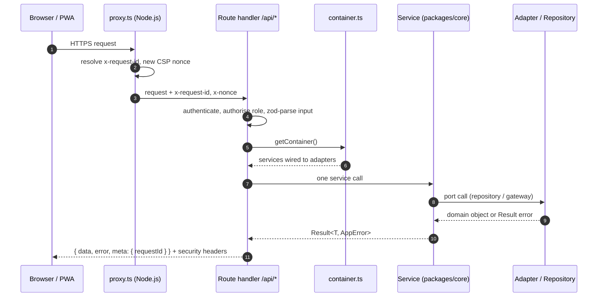
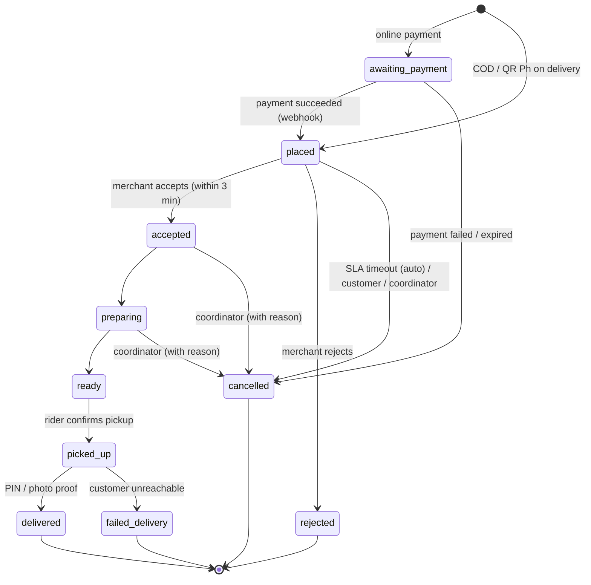

# Klik Go — Architecture

Living document. Expands `docs/BUILD_PLAN.md` §5. Update it in the same PR whenever the shape of the system changes.

## 1. System at a glance

```
Customer PWA / Rider PWA / (later Expo)          PayMongo webhooks
             │  HTTPS only                            │
             ▼                                        ▼
   apps/web  (Next.js 16 App Router on Vercel)  — the ONLY public entry point (BFF)
   ├─ src/proxy.ts             request id + per-request CSP nonce (Next 16 Proxy, always Node.js)
   ├─ src/app/(customer) /     ├─ app/merchant/*   ├─ app/rider/*   ├─ app/admin/*      (UI surfaces)
   ├─ src/app/api/*            BFF route handlers: authN, RBAC, zod validation, rate limit
   └─ src/server/container.ts  composition root → packages/core services (ports)
                                       │
             packages/adapters: PinoLogger, SystemClock (Phase 0) · PrismaRepos, PayMongoGateway,
             SemaphoreSms, GoogleGeocoder, WebPushNotifier, GeminiMenuParser, SupabaseStorage (later)
                                       │
          Supabase: Postgres 17 + PostGIS (RLS on), Auth, Realtime (private channels),
                    Storage (private KYC bucket), pg_cron jobs
```

Rules (non-negotiable, see `CLAUDE.md`):
- Browsers never receive the service-role key or any gateway secret. All writes go through `/api/*`.
- Realtime is read-only for clients, through RLS-authorised private channels (`order:{id}`).
- Money is integer centavos end to end. Times are stored UTC and shown in Asia/Manila.
- Every order status change goes through `OrderStateMachine` and writes an `order_events` row.

## 2. Request flow



The response envelope is always `{ data, error, meta }`, with exactly one of `data` or `error` non-null. `meta.requestId` matches the `x-request-id` header and every log line for that request. Error codes map to HTTP statuses in `apps/web/src/server/http/api-response.ts`:

| Code | HTTP |
|---|---|
| `VALIDATION_FAILED` | 400 (with `issues[]`) |
| `UNAUTHORIZED` | 401 |
| `FORBIDDEN` | 403 |
| `NOT_FOUND` | 404 |
| `CONFLICT` | 409 (e.g. invalid status transition) |
| anything else | 500 with a generic message; details only in logs |

## 3. Roles

| Role | Sign-in | Scope | Notes |
|---|---|---|---|
| `customer` | Phone OTP (Supabase Auth + Semaphore Send-SMS hook) | own orders and addresses | default role on sign-up |
| `rider` | Phone OTP | offered/assigned orders only | KYC before `active` |
| `merchant_owner` | Email + password + TOTP (AAL2), invite-only | one merchant | can invite staff |
| `merchant_staff` | Email + password + TOTP, invite-only | one merchant | order queue, sold-out toggles |
| `coordinator` | Email + password + TOTP, invite-only | one zone | dispatch override, refunds in zone |
| `admin` | Email + password + TOTP | everything | first admin bootstrapped from `ADMIN_EMAIL` |

A user can hold many roles (`user_roles`, many-to-many, with optional `merchant_id` / `zone_id`). The server never trusts a role claim from the client; it re-reads `user_roles`.

## 4. Order state machine (MVP)

Based on docs/BUSINESS.md §5.2, with the SLA escalation from docs/BUILD_PLAN.md §4E.



Dispatch state is separate: `unassigned → offered → assigned → at_store → picked_up`. Each offer is a `dispatch_offers` row with a 30 s expiry (pg_cron).

Merchant SLA escalation: alert at 0 s, SMS at 60 s, coordinator call at 120 s, auto-cancel + refund at 180 s.

Every transition records `order_events(from_status, to_status, actor_id, actor_role, meta)`. Cancellations require a reason and an actor.

## 4b. Data model and security in the database (Phase 1)

Full diagram and policy list: `docs/ERD.md` (generated from the database). Source of truth: `supabase/migrations`.

- **33 tables, 21 enums.** Enums mirror `packages/types/src/domain.ts`; a test fails if they drift. Money is `integer` centavos with `>= 0` checks; locations are `geography(…, 4326)` with GiST indexes.
- **Integrity lives in SQL**, so no code path (BFF, admin SQL, a future NestJS service) can corrupt data:
  - `orders_total_adds_up`, `order_items_line_total`: totals must add up to the centavo.
  - `order_status_transitions` + trigger `orders_status_guard`: only the transitions in §4 are allowed; status timestamps are stamped automatically.
  - Trigger `orders_log_status`: every status change writes `order_events` with the actor from `klikgo.actor_id` / `klikgo.actor_role` (set by the server per transaction) or the JWT user.
  - `ledger_entries_balanced` (deferred constraint trigger): each ledger transaction balances at commit.
  - `order_events`, `ledger_entries`, `audit_logs` are append-only (update/delete raise).
  - A merchant must sit inside its zone; a zone's radius must fit its type (barangay 3–5 km, city 8–15 km, provincial 20–40 km).
  - One accepted dispatch offer per order; one default address per user.
- **RLS on every table**, written for the `authenticated` / `anon` roles. Role checks use SECURITY DEFINER helpers in the unexposed `private` schema (`has_role`, `is_admin`, `is_merchant_member`, `is_merchant_owner`, `coordinates_zone`, `current_rider_id`, …) so policies never recurse. Child tables (order items/events, payments, menus) reuse the parent's policy with `exists (select 1 from parent …)`.
- **Grants complement RLS**: API roles get `select` everywhere (RLS filters rows) and write only specific tables/columns: own profile name/locale, own addresses, menu tables for merchant members, store settings (not commission/status), rider online flag and location, KYC uploads, ratings for own delivered orders, push subscriptions, notification read flag. Orders, payments, ledger, payouts, roles, approvals: server only.
- **Who sees what** (tested in `packages/db/test/rls-visibility.db.test.ts`):

| Role | Sees |
|---|---|
| anonymous | active zones, live merchants and their menus, active fee rules |
| customer | own profile, roles, addresses, orders (+ items, events, payments), ratings, redemptions, referrals, stamps, push subscriptions, notifications; the rider delivering their active order (row + live location) |
| merchant staff | their store (any status), its menu and orders, ratings of the store |
| merchant owner | staff view + invites, ledger entries and payouts of the store, roles of their team |
| rider | own rider row, location, breadcrumbs, offers, orders offered/assigned to them, own ledger and payouts; never their KYC files back |
| coordinator | their zone (even if paused), its merchants, riders (+ profiles, locations, breadcrumbs), orders and offers |
| admin | everything, including KYC documents and the audit log; webhook events stay server-only |

- **Storage**: `menu-photos` (public read; merchant members write `menu-photos/<merchant_id>/…`) and `rider-kyc` (private; riders write `rider-kyc/<rider_id>/…`, only admins read; the BFF will serve short-lived signed URLs and audit each view).
- **Geo helpers**: `zone_for_point(point)` returns the smallest active zone covering a pin; `nearest_available_riders(point, limit, max_m)` returns approved, online riders seen in the last 2 minutes and not on an unfinished order, nearest first (KNN `<->` on GiST), as SECURITY INVOKER so callers only see what RLS allows.
- **Prisma** mirrors the database via `pnpm --filter @klikgo/db db:pull` (introspection + normalisation: minimal `auth.users`, partial indexes dropped). Model and field names stay snake_case, exactly as in SQL.

## 4c. Authentication and authorization (Phase 2)

- **Supabase Auth via `@supabase/ssr`**: sessions live in HTTP-only cookies; the browser never talks to Supabase Auth directly. All auth goes through BFF routes (`/api/auth/*`).
- **Customers and riders: phone OTP.** `/api/auth/otp` normalises to +63 (libphonenumber-js) and checks Klik Go's limits (5 codes/hour/phone, 20/hour/network, 10 guesses/15 min/phone) before Supabase sends anything. Supabase calls the **Send-SMS hook** `/api/hooks/send-sms` (Standard Webhooks signature, `SEND_SMS_HOOK_SECRET`), which texts through `SemaphoreSmsSender` (or `DevSmsSender` when no key is set; it logs a masked number, never the code).
- **Staff: email + password + TOTP.** Merchant, coordinator and admin accounts are invite-only. Staff surfaces and APIs require AAL2 (`mfa_required` → `/auth/mfa`). Passwords: 12+ characters (NIST 800-63B). Sign-in attempts are rate-limited per email and per network.
- **Invites**: an admin calls `/api/admin/invites` → `InviteService` (core) checks `staff.invite` → `SupabaseStaffAccountGateway.createInvite` (service role, `generateLink`) creates the account → the scoped role is granted → the invite is recorded (SHA-256 of the token hash) → the API returns a Klik Go link `/auth/confirm?token_hash=…&type=invite&next=/auth/set-password`, verified server-side. Until an email provider exists, the admin shares the link directly.
- **Authorization in core**: `AuthorizationService.decide(user, action)` → allowed, or `unauthenticated` / `mfa_required` / `forbidden`. Roles come from `user_roles` on every request (`getSessionUser`); identity from `supabase.auth.getUser()`; the AAL from the session. Layout guards: `requireSurface("merchant" | "admin" | "rider")` redirect to sign-in or `/auth/mfa`, or call `forbidden()` → HTTP 403 (`app/forbidden.tsx`). API guards: `requireUser`, `requireAction`.
- **Session refresh**: the proxy (`src/proxy.ts`) calls `getClaims()` on every request that carries a Supabase cookie, rotating expired access tokens into fresh cookies. Logout (`/api/auth/sign-out`) revokes the refresh token; the old cookies stop working.
- **Rate limits** are counters in `private.rate_limit_counters` (fixed windows, atomic upsert in `private.hit_rate_limit`, server-only, cleaned hourly by pg_cron) behind the `IRateLimiter` port.
- **Bootstrap**: `pnpm bootstrap:admin` (ADMIN_EMAIL) creates or recovers the first admin, grants the role, writes an audit row and prints a one-time link. Idempotent.

| Surface | Path | Who | Second factor |
|---|---|---|---|
| customer | `/` (and later `(customer)/*`) | `customer` (everyone who signs up) | no |
| rider | `/rider` | `rider` | no |
| merchant | `/merchant` | `merchant_owner`, `merchant_staff` | AAL2 |
| admin | `/admin` | `admin`, `coordinator` | AAL2 |

## 4d. Merchant onboarding and menus (Phase 3)

- **Applications → stores.** `/partners` posts to `/api/partners/applications` (public, rate-limited per network, honeypot). Rows go to `merchant_applications` (server-written only; admins read all, coordinators their zone) with the zone that covers the pin, or none. `/admin/merchants` approves through `MerchantOnboardingService.approve`: `IStaffAccountGateway.createInvite` creates the owner's account, then `PrismaMerchantApplicationRepository.approve` creates the merchant (active, closed, unique slug), the `merchant_owner` role, the hashed invite, the application status and an audit row in **one transaction**. The admin gets the one-time invite link (Phase 2 flow).
- **Commission.** `merchants.commission_bps` is the agreed rate; `founding_commission_until` waives it (0%) for founding partners' first 90 days. `effectiveCommissionBps(merchant, now)` in core is what settlement (Phase 9) will use.
- **Settings.** Weekly hours are `merchants.hours` (`{ mon: [{open, close}], … }`, at most two windows a day, validated by `WeeklyHoursSchema`); holiday closures are `merchant_closures`; `service_radius_km` is capped by a trigger at the zone's `max_radius_km`. Owners change settings (`merchant.settings`); any team member opens/closes the store and edits the menu (`merchant.manage`).
- **Menus.** `MenuService` converts pesos typed by people into centavos (`pesosToCentavos`), checks that categories and photo paths belong to the store, and every repository write filters by `merchant_id` as well as the row id.
- **Photos.** The browser resizes to ≤1280 px WebP ≤ 200 KB (`lib/compress-image.ts`), asks `/api/merchant/:id/menu/photos` for a one-time signed upload URL (service role, path `<merchant_id>/<uuid>.webp`) and PUTs the file straight to Storage. The `menu-photos` bucket accepts only `image/webp` ≤ 200 KB, so the rule holds even for a client that skips compression.
- **AI menu import.** `/api/merchant/:id/menu/import` (multipart photo) → `MenuImportService` (type/size checks, 10 photos/hour/store) → `IMenuParser`. Production uses `GeminiMenuParser` (REST `generateContent`, `responseSchema` JSON, zod-validated, prices parsed to centavos); only the photo and a fixed prompt are sent. Tests and demos use `FakeMenuParser` (`MENU_PARSER=fake`, ignored on Vercel production); with no key the import page says it isn't set up. Drafts are never saved by this call: the merchant edits them and `/import/confirm` saves them through `MenuService.importReviewedItems`.
- **TanStack Query** holds the menu manager's server state (mutations invalidate the menu query).

## 5. Folder map

```
apps/
  web/                      Next.js BFF + all web surfaces (the only deployable)
    src/proxy.ts            Next 16 Proxy: request id + CSP nonce on every request
    src/app/                routes (UI) and src/app/api/* (BFF handlers); icon.svg, apple-icon.png, fonts.ts
    src/server/             container.ts, env.ts (zod), http/ (envelope, request id)
    src/security/           CSP builder, static security headers
    src/i18n/               next-intl config (en, fil; cookie NEXT_LOCALE)
    messages/               en.json, fil.json (same keys, unit-tested)
    public/brand/           production logo SVG/PNG and PWA icons (docs/BRAND.md)
    e2e/                    Playwright specs (projects: mobile-pixel-7, desktop-chrome)
packages/
  core/                     pure TS domain: services, ports, Result, errors, money, time
    src/testing/            Fakes for ports (FakeClock, MemoryLogger, …)
  adapters/                 port implementations (pino logger, system clock, later gateways)
  db/                       Prisma 7 schema + client (mirrors supabase/migrations); prisma.config.ts
    scripts/                pull-schema.mjs (db:pull/db:check), generate-erd.mjs (db:erd)
    src/testing/            DbFixtures + asUser() for DB tests and Cucumber
    test/                   DB integration tests (*.db.test.ts): RLS, geo, integrity, seed
  types/                    shared zod schemas (API envelope, request/response DTOs)
  config/                   tsconfig bases, ESLint flat config (+ boundary rules), Prettier, design tokens
  ui/                       shared shadcn/ui-style components (Button, BrandLogo, cn)
features/                   Cucumber.js: *.feature, step_definitions/, support/ (world: API client, DB helper, browser)
supabase/                   CLI config, migrations/, seed.sql
scripts/                    repo tooling (with-server.mjs)
.github/                    CI (+ actions/setup composite), CodeQL, Dependabot, PR template
docs/brand/                 logo source (Excalidraw SVG), original PNG, outlined SVG
```

Package names are `@klikgo/<name>`. Workspace packages export TypeScript source (no build step); Next.js compiles them through `transpilePackages`.

## 6. Cross-cutting concerns

### Security headers
- **CSP** (per request, in `src/proxy.ts`, the Next.js 16 Proxy that replaced middleware): `default-src 'self'`; `script-src 'self' 'nonce-…' 'strict-dynamic'` (plus `'unsafe-eval'` only in `next dev`); `object-src 'none'`; `base-uri 'self'`; `form-action 'self'`; `frame-ancestors 'none'`; `upgrade-insecure-requests`. The Supabase origin is added to `connect-src` (https + wss) and `img-src` when `NEXT_PUBLIC_SUPABASE_URL` is set. `style-src` allows `'unsafe-inline'` because Next.js injects style attributes; styles cannot run code.
- **Static** (`next.config.ts`): HSTS 2 years + preload, `X-Frame-Options: DENY`, `X-Content-Type-Options: nosniff`, `Referrer-Policy: strict-origin-when-cross-origin`, a `Permissions-Policy` that allows only geolocation and camera for our own origin, COOP `same-origin`. `X-Powered-By` is removed.
- Because the nonce changes per request, pages render dynamically (`connection()` in the root layout).

### Logging
- `Logger` port in core; `createPinoLogger` adapter writes one JSON line per event with `service`, `level`, ISO `time` and `requestId`.
- Personal data and credentials are redacted by key (`phone`, `email`, `fullName`, `address`, `authorization`, `cookie`, `password`, `token`, …), up to 3 levels deep.

### Configuration
- `apps/web/src/server/env.ts` validates env vars with zod. Errors name the variable, never its value. `.env.example` lists names only.

### i18n
- next-intl without locale-prefixed URLs (links shared in FB/Viber groups stay short). Locale comes from the `NEXT_LOCALE` cookie, default `en`, also `fil`. `timeZone` is fixed to Asia/Manila.

### Design system
- Brand: the KGo logo, blue `#228be6` + yellow `#ffd43b`, Lilita One display type. Rules, files and contrast table in `docs/BRAND.md`.
- Tailwind v4, CSS-first. Tokens live in `packages/config/tailwind/tokens.css` (`brand-*` = Open Color blue, `accent-*` = Open Color yellow, `ink`, `surface`, `font-display`, `min-h-tap` = 44 px), mirrored in `packages/config/src/tokens.ts`. A unit test keeps them in sync and checks WCAG AA contrast.
- Lilita One is self-hosted with `next/font/local` from `@fontsource/lilita-one` (`apps/web/src/app/fonts.ts`), so no request goes to Google and the CSP stays `font-src 'self'`.
- shadcn/ui conventions (`components.json`, `cn`, `cva`, Radix `Slot`) in `packages/ui`.

## 7. Testing strategy

| Layer | Tool | Where | Runs against |
|---|---|---|---|
| Domain services, helpers | Vitest | `*.test.ts` next to code | in-memory Fakes |
| Route handlers | Vitest | `src/app/api/**/route.test.ts` | container with real adapters, no network |
| Business scenarios | Cucumber.js (Gherkin) | `features/` | running server (`next start`) + local Supabase for `@db` |
| UI flows | Playwright | `apps/web/e2e/` | production build, Pixel 7 + desktop Chrome, axe a11y |
| Database / RLS | Vitest against the local DB (`pnpm test:db`) + Cucumber `@db` | `packages/db/test`, `features/` | `supabase start`; each test in a rolled-back transaction |

CI (`.github/workflows/ci.yml`) runs on Node 26 with pnpm 12 installed from npm by `.github/actions/setup` (first-party actions only): job **static** (format, lint, typecheck, unit + coverage) and job **e2e** (supabase start → db reset → DB integration tests → Prisma/ERD drift checks → build → start server → Cucumber → Playwright, reports uploaded as artifacts). CodeQL runs on every PR and weekly.

## 8. Deployment

- Vercel project with **Root Directory = `apps/web`**, framework Next.js, Node.js 26.x (or 24.x). Vercel installs at the monorepo root with the pnpm version in `packageManager` (setup notes: docs/OPEN_QUESTIONS.md Q1).
- Env vars are set in Vercel (Preview and Production) and never committed.
- Before taking real orders: Vercel Pro (Hobby is non-commercial) and Supabase Pro (backups, no pausing). See docs/BUILD_PLAN.md §2.

## 9. Decision log

| Date | Decision | Why |
|---|---|---|
| 2026-11-04 | Next.js BFF + `packages/core` instead of NestJS | BUILD_PLAN §2: one host, no cold starts, keeps SOLID ports |
| 2026-11-04 | Supabase SQL migrations are the source of truth; Prisma mirrors | RLS, PostGIS and pg_cron cannot be expressed in Prisma schema |
| 2026-11-04 | Next.js 15.5, Prisma 6, TypeScript 5.9, ESLint 9, Tailwind 4 | Plan specified Next 15 (superseded 2026-11-05) |
| 2026-11-05 | Latest stable everywhere: Node 26 LTS, pnpm 12, Next 16, React 19.3, TS 6.0, ESLint 10, Vitest 5, Prisma 7, Playwright 1.64, Supabase CLI 3 | Owner: "use what is up to date" (OPEN_QUESTIONS Q2). TS 7 and Prisma 8 wait (Q9) |
| 2026-11-05 | Prisma 7: CLI URL in `packages/db/prisma.config.ts` (`DIRECT_URL`), runtime via `@prisma/adapter-pg` (`DATABASE_URL`) | Prisma 7 removed `url`/`directUrl` from the schema |
| 2026-11-05 | pnpm 12 supply-chain defaults kept: `allowBuilds` allowlist, `minimumReleaseAge` (1 day) | Blocks freshly published (possibly hijacked) versions; Dependabot cooldown is 2 days |
| 2026-11-05 | KGo brand (blue `#228be6`, yellow `#ffd43b`, Lilita One) | Owner-supplied logo (OPEN_QUESTIONS Q7); see docs/BRAND.md |
| 2026-11-05 | Order transitions and event logging enforced by DB triggers | Defence in depth: no path can skip a step or change status without an `order_events` row; Phase 6 OrderStateMachine uses the same table |
| 2026-11-05 | Clients get column-level write grants only; orders/payments/ledger are server-written | Least privilege on top of RLS; a leaked anon/user JWT cannot alter money or order state |
| 2026-11-05 | SECURITY DEFINER helpers live in schema `private` | Not exposed by PostgREST; avoids RLS recursion; tested |
| 2026-11-05 | Prisma schema generated by introspection (`db:pull`), not hand-written | SQL is the source of truth; CI drift check keeps them equal |
| 2026-11-05 | DB tests run as real roles via `asUser()` (role + `request.jwt.claims`) in rolled-back transactions | Proves RLS exactly as clients hit it; tests never change the seed |
| 2026-11-05 | Auth only through BFF routes with `@supabase/ssr` cookies; roles re-read from `user_roles` per request | Never trust client roles (CLAUDE.md); one place for rate limits and logging |
| 2026-11-05 | Klik Go's own OTP/sign-in rate limits in Postgres (`private.hit_rate_limit`) | Supabase sees every request from the BFF's address, so its per-IP limits cannot tell customers apart; no extra paid service |
| 2026-11-05 | Invite links built from `generateLink` token hashes and verified server-side (`/auth/confirm`) | Works before an email provider exists (admin shares the link); no tokens in URL fragments |
| 2026-11-05 | `forbidden()` (Next 16 `experimental.authInterrupts`) for wrong-role access | Real HTTP 403 for the acceptance criterion; revisit if the API changes when it leaves experimental |
| 2026-11-05 | Partner applications in their own table, not `merchants(status=pending)` | An applicant has no account yet and `merchants.owner_id` is required; approval creates both in one transaction (OPEN_QUESTIONS Q15) |
| 2026-11-05 | Photos uploaded browser → Storage via a BFF-issued signed URL; bucket enforces WebP ≤ 200 KB | No image bytes through Vercel functions; the size rule cannot be bypassed |
| 2026-11-05 | Leaflet + OpenStreetMap tiles for the pin map | No API key for the MVP; swap behind the Phase 4 maps adapter if tile usage grows (Q17) |
| 2026-11-04 | Cookie-based locale (no `/fil/...` URLs) | short shareable links; SEO not a pilot goal |
