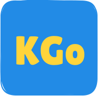

# Klik Go brand

The brand is the **KGo** logo: yellow Lilita One lettering on a hand-drawn blue tile. It was supplied by the owner on 2026-11-05 (docs/OPEN_QUESTIONS.md Q7) and replaces the Phase 0 placeholder teal pin. It implements docs/BUSINESS.md §4.1 ("bold primary colour, clean typography, friendly and local").

The product UI uses an **operations-room** structure across every surface: cool canvas floor, white panels, ink masthead, one action blue, Inter plus mono figures, hairline rules, and status as a glyph plus a word. Colours stay Klik Go's; patterns live in `packages/config` and `packages/ui`.

## Logo files

| File | Use |
|---|---|
| `docs/brand/klik-go-logo-source.svg` | Original Excalidraw export, kept verbatim (text uses an embedded font subset). Edit the logo from this. |
| `docs/brand/klik-go-logo-original.png` | Original PNG as supplied (210 × 207). |
| `docs/brand/klik-go-logo.svg`, `apps/web/public/brand/klik-go-logo.svg` | **Production logo.** Same artwork with the lettering converted to outlines (no font dependency) and a transparent background. |
| `apps/web/public/brand/klik-go-logo-512.png`, `docs/brand/klik-go-logo-512.png` | 512 px PNG of the production logo (social, docs, merchant materials). |
| `apps/web/src/app/icon.svg` | Browser favicon (Next.js file convention). |
| `apps/web/src/app/apple-icon.png` | iOS home-screen icon, 180 px, full-bleed blue (iOS rounds the corners itself). |
| `apps/web/public/brand/icon-192.png`, `icon-512.png` | Android / PWA icons for the Phase 4 manifest (full-bleed, maskable-safe). |
| `packages/ui/src/components/brand-logo.tsx` | `<BrandLogo />` React component. Use this in the UI; pass `decorative` when a visible "Klik Go" name sits beside it. |

Regenerating the outlines: the lettering is Lilita One at 80.26 px, shaped with HarfBuzz and converted with fontTools. The path data lives in `packages/ui/src/components/brand-logo-paths.ts`; the SVG/PNG files above are rendered from it.

Clear space: keep at least ¼ of the logo width empty around it. Minimum size: 24 px (favicon), 40 px in UI.

Don't recolour the tile or the lettering, add effects or outlines, stretch it, or set "KGo" in another font.

## Colours

Both logo colours come from [Open Color](https://yeun.github.io/open-color/) (the palette Excalidraw uses), so the full blue and yellow scales stay in the theme for charts and rare tints. **UI code should reach for role tokens** (`bg-action`, `text-ink`, `border-rule`) rather than `brand-800`.

### Role tokens

| Role | Hex | Job |
|---|---|---|
| `ink` | `#0B1F33` | Primary text; double rule on a total row |
| `ink-muted` | `#4A5A6A` | Descriptions, table heads, term labels |
| `ink-faint` | `#647186` | Not-yet-reached steps only |
| `canvas` | `#F1F5F9` | Page floor behind panels |
| `sheet` | `#FFFFFF` | Panels, controls, table bodies |
| `sheet-alt` | `#F7F9FC` | Table heads, totals, insets, disabled fills |
| `rule` | `#D5DEE8` | Panel borders, row separators (not input borders) |
| `rule-strong` | `#6B8499` | Operable strokes (inputs, secondary borders) |
| `masthead` | `#0B1F33` | Institutional band and desk index rail |
| `masthead-ink` | `#FFFFFF` | Title and current rail entry text |
| `masthead-muted` | `#A8C4DC` | Group headings and inactive rail labels |
| `action` | `#1971C2` | Primary buttons, links, refs, live counts |
| `action-hover` | `#1864AB` | Primary hover |
| `action-wash` | `#E7F5FF` | Ghost hover, tinted chips, selection |
| `seal` | `#C92A2A` | Destructive, errors, required marks |
| `seal-wash` | `#FFF5F5` | Error and destructive hover fill |
| `certified` | `#16734A` | Delivered, paid, approved |
| `certified-wash` | `#EAF8F0` | Success mark ground |
| `awaiting` | `#8A5A00` | Held, pending, preparing |
| `awaiting-wash` | `#FFF9DB` | Pending mark ground |
| `accent` (turmeric) | `#FFD43B` | Logo and badges only, with ink text |

### Logo / ramp tokens (keep for charts and the lockup)

| Token (Tailwind) | Hex | Role |
|---|---|---|
| `brand-600` | `#228be6` | **Logo blue.** Logo tile, large brand surfaces, icons, browser `theme-color`. Never buttons. |
| `brand-800` / `action` | `#1971c2` | **Action blue.** Primary buttons, links. |
| `brand-900` / `action-hover` | `#1864ab` | Hover/pressed state of actions. |
| `brand-50`–`brand-500`, `brand-700` | Open Color blue 0–5, 7 | Tints for charts. |
| `accent-400` / `accent` | `#ffd43b` | **Logo yellow / turmeric.** Lettering, badges (always with `ink` text). |
| `accent-50`–`accent-900` | Open Color yellow 0–9 | Warning surfaces, promo badges. |

Source of truth: `packages/config/tailwind/tokens.css` and `packages/config/src/tokens.ts`. `src/tokens.test.ts` keeps them identical and enforces the contrast rules below. Legacy aliases `surface` / `surface-muted` map to `sheet` / `canvas` during migration.

A `.dark` role restatement exists in tokens.css for a later ship; light mode is the only shipped theme at pilot.

### Contrast rules (WCAG 2.2 AA)

| Pairing | Ratio | Allowed for |
|---|---|---|
| White on `action` (`#1971C2`) | 5.0 : 1 | Any text, buttons |
| White on `action-hover` | 6.1 : 1 | Primary hover labels |
| White on `masthead` | 16.7 : 1 | Masthead and rail text |
| `ink` on sheet or canvas | ≥ 15 : 1 | Body text |
| `ink-muted` on sheet / canvas | ≥ 4.5 : 1 | Secondary text |
| `action` on sheet / canvas / wash | ≥ 4.5 : 1 | Links and ghost labels |
| `seal` on sheet / seal-wash | ≥ 4.5 : 1 | Error and destructive text |
| `certified` on white / wash | ≥ 4.5 : 1 | Success mark text |
| `awaiting` on white / wash | ≥ 4.5 : 1 | Pending mark text |
| `ink` on turmeric (`#FFD43B`) | 11.7 : 1 | Badge and wordmark type |
| White on logo blue (`#228BE6`) | 3.6 : 1 | Large text and icons only; **never** body text or buttons |
| Turmeric text on white | 1.4 : 1 | **Never** |
| `rule-strong` on canvas / sheet | ≥ 3 : 1 | Input and secondary borders (WCAG 1.4.11) |

That is why primary buttons are `action` / `brand-800`, not the logo blue: the logo blue is too light for white button text. If a second thing on the screen is action blue, one of them is wrong.

## Typography

- **UI: Inter** (`font-sans`), self-hosted via `next/font` + `@fontsource/inter`. Default body is 14px (`text-body`) on the PWA so Filipino strings fit.
- **Figures: JetBrains Mono** (`font-mono`) with `font-variant-numeric: tabular-nums` for money, reference numbers, dates, times, and counts.
- **Display: Lilita One** (`font-display`), self-hosted. **Wordmark only** via `<BrandLogo />` / the lockup — never for page titles, legal headings, prices, or long Taglish copy.

Type ranks (utilities in `globals.css`): issue, document, title, lede, body, record, label, mark.

## Radii, controls, elevation

- **Radii:** 6px (`rounded-control`) on operable controls and tokens; 10px (`rounded-panel`) on panels. Circular exceptions: avatars, map pins, and a 12px ring on an order-progress spine. No `rounded-full` buttons.
- **Heights:** 44px (`h-tap`) on customer, rider, and merchant phone; 36px (`h-control`) on the dense desk from `lg` up only.
- **Elevation:** hairline `rule` + quiet `shadow-panel`. One heavier `shadow-overlay` for the focused skip link. No blur or glass.
- **Focus:** global `:focus-visible` is a 2px action outline at a 2px offset.
- **Motion:** colour/border 150ms; once-only 240ms `mark-settle` on status marks behind `motion-safe`. Honor `prefers-reduced-motion`.

## Components

Primitives live in `packages/ui` (CVA + shadcn New York + Lucide): Button, Field, Sheet, DataTable, StatusMark, Masthead, IndexRail, BottomNav, Price, Badge, EmptyState, Skeleton, Tabs, ListRow, PhotoFallback, OrderProgress. Story page: `/dev/ui`.

## Voice

Friendly, local and dependable, not corporate (docs/BUSINESS.md §4.1). Taglish is welcome. Tagline: "Delivered to your door, wherever you are." / "Hatid sa pinto mo, nasaan ka man."
