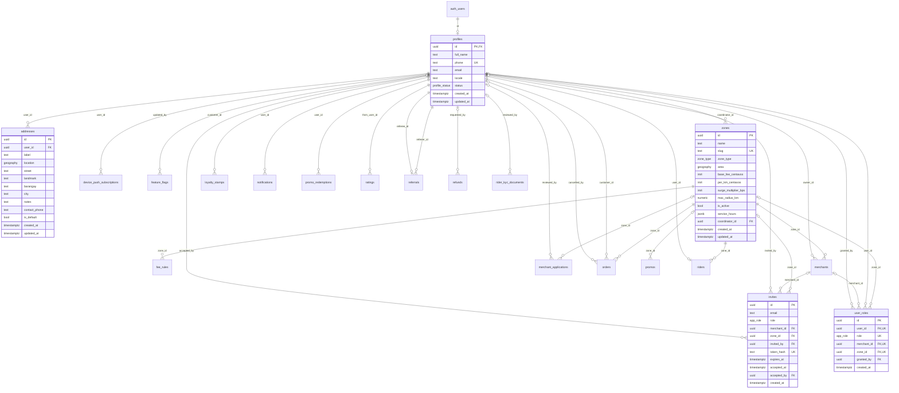
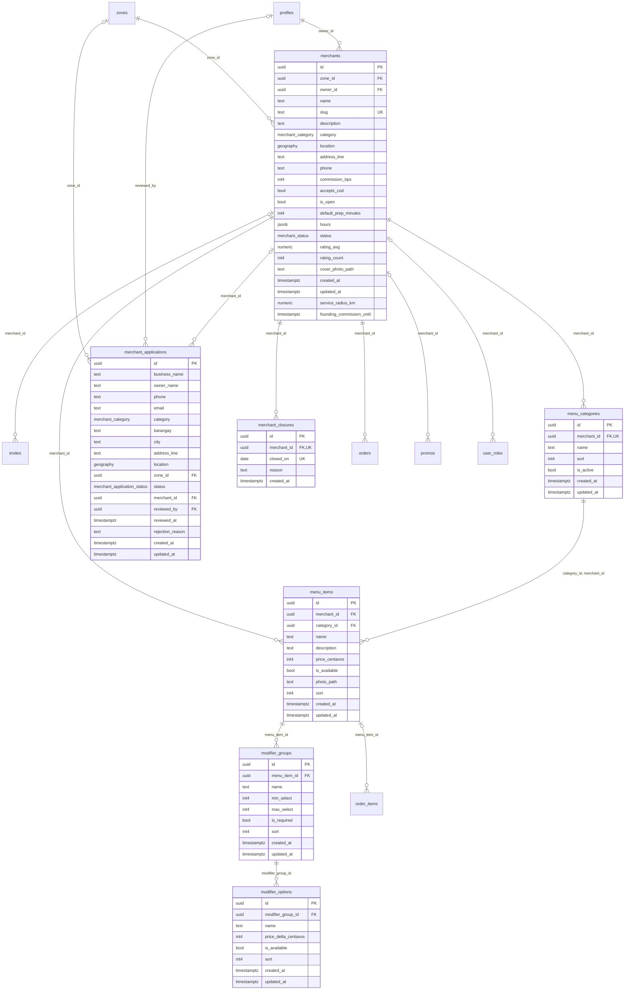
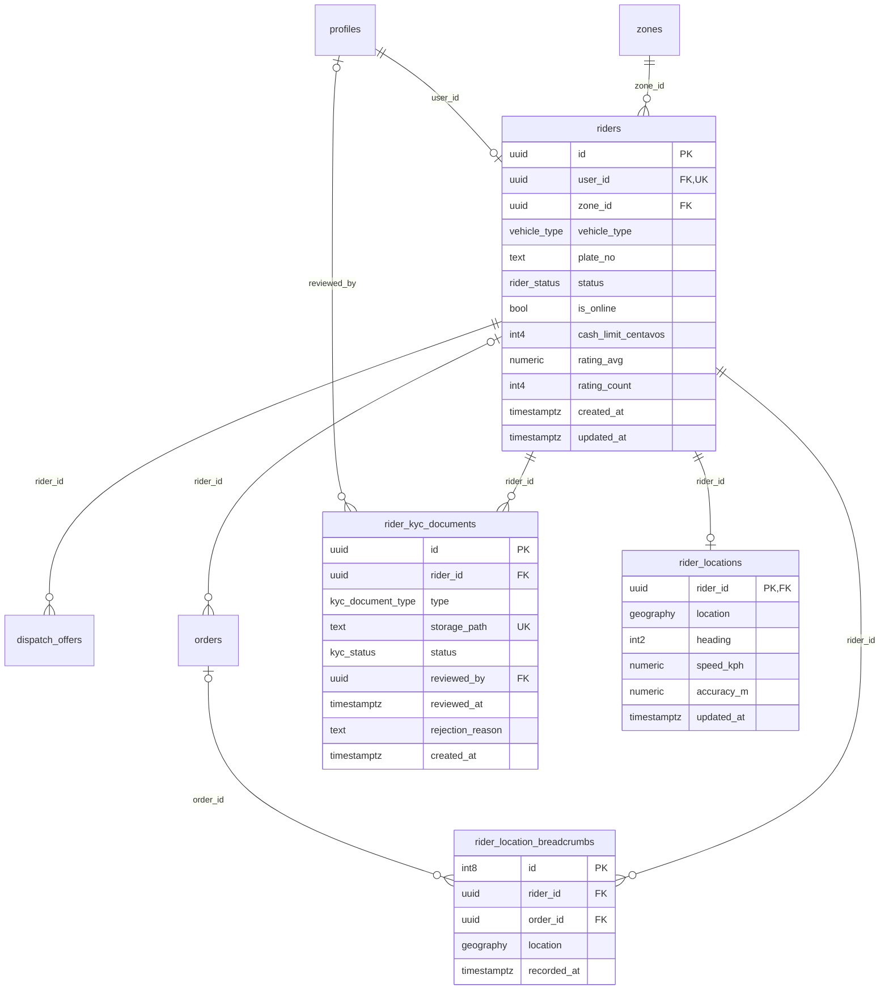
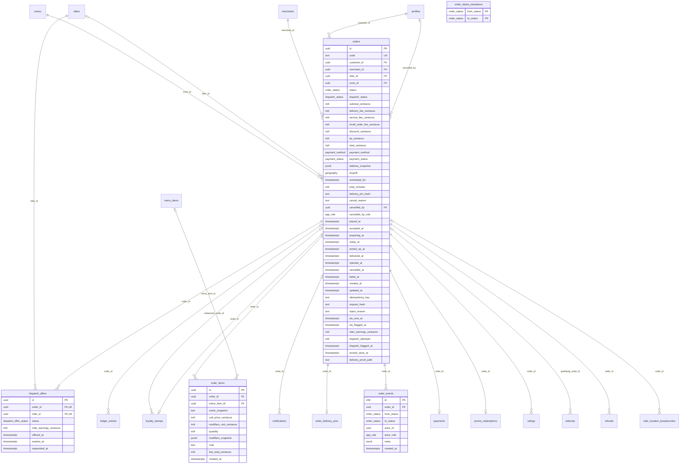
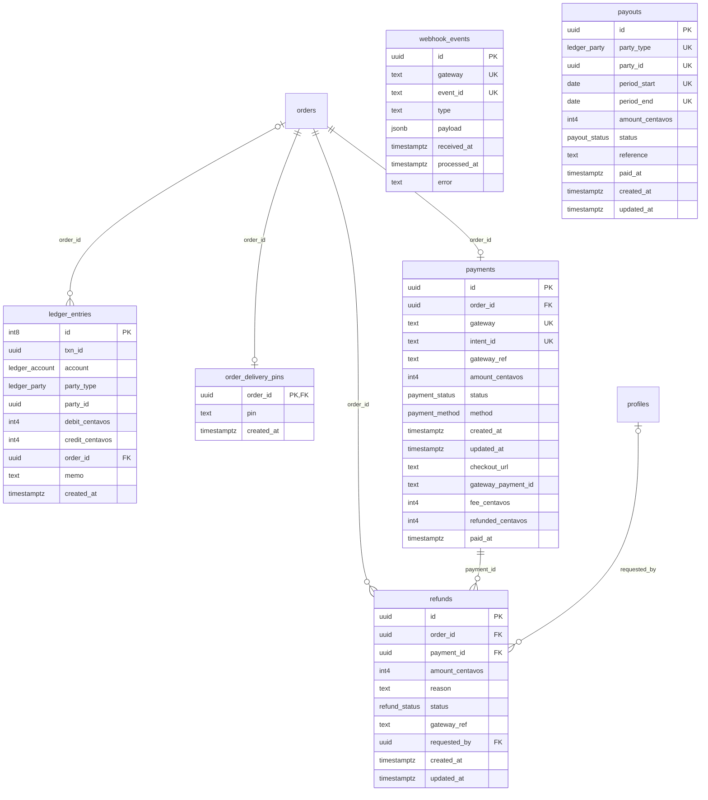
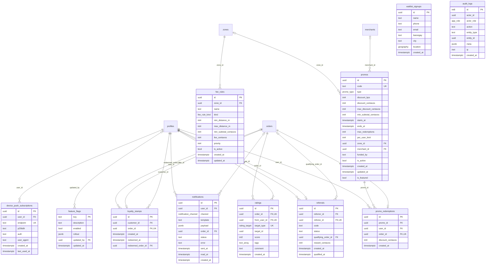

# Klik Go — Entity relationship diagram

> Generated from the migrated database by `pnpm --filter @klikgo/db db:erd`; do not edit by hand.
> Source of truth: `supabase/migrations`. CI fails if this file is out of date.

Conventions: money columns are integer centavos (`*_centavos`), times are `timestamptz` (UTC),
locations are PostGIS `geography` (SRID 4326). `PK` primary key, `FK` foreign key, `UK` unique.
Cardinality: `||` exactly one, `|o` zero or one, `o{` zero or many. `auth_users` is Supabase Auth's user table.

## People, roles and zones

## Merchants and menus

## Riders

## Orders and dispatch

## Payments and money

## Engagement and operations

## Row-level security policies

Every table has RLS on. Policies decide which rows each role sees; column grants
(`supabase/migrations/20261105800000_geo_and_grants.sql`) decide what clients may change.
Role helpers live in the `private` schema (`has_role`, `is_admin`, `is_merchant_member`,
`coordinates_zone`, `current_rider_id`, …).

| Table | RLS | Policies |
|---|---|---|
| `addresses` | on | `addresses_admin_select` (select · authenticated) `addresses_owner_all` (all · authenticated) |
| `audit_logs` | on | `audit_logs_select_admin` (select · authenticated) |
| `device_push_subscriptions` | on | `device_push_subscriptions_own` (all · authenticated) |
| `dispatch_offers` | on | `dispatch_offers_select` (select · authenticated) |
| `feature_flags` | on | `feature_flags_select` (select · authenticated) |
| `fee_rules` | on | `fee_rules_select` (select · anon, authenticated) |
| `invites` | on | `invites_select` (select · authenticated) |
| `ledger_entries` | on | `ledger_entries_select` (select · authenticated) |
| `loyalty_stamps` | on | `loyalty_stamps_select` (select · authenticated) |
| `menu_categories` | on | `menu_categories_member_write` (all · authenticated) `menu_categories_select` (select · anon, authenticated) |
| `menu_items` | on | `menu_items_member_write` (all · authenticated) `menu_items_select` (select · anon, authenticated) |
| `merchant_applications` | on | `merchant_applications_admin_select` (select · authenticated) `merchant_applications_coordinator_select` (select · authenticated) |
| `merchant_closures` | on | `merchant_closures_member_write` (all · authenticated) `merchant_closures_select` (select · anon, authenticated) |
| `merchants` | on | `merchants_select` (select · anon, authenticated) `merchants_update_member` (update · authenticated) |
| `modifier_groups` | on | `modifier_groups_member_write` (all · authenticated) `modifier_groups_select` (select · anon, authenticated) |
| `modifier_options` | on | `modifier_options_member_write` (all · authenticated) `modifier_options_select` (select · anon, authenticated) |
| `notifications` | on | `notifications_mark_read` (update · authenticated) `notifications_select` (select · authenticated) |
| `order_delivery_pins` | on | `order_delivery_pins_select_customer` (select · authenticated) |
| `order_events` | on | `order_events_select` (select · authenticated) |
| `order_items` | on | `order_items_select` (select · authenticated) |
| `order_status_transitions` | on | `order_status_transitions_read` (select · anon, authenticated) |
| `orders` | on | `orders_select` (select · authenticated) |
| `payments` | on | `payments_select` (select · authenticated) |
| `payouts` | on | `payouts_select` (select · authenticated) |
| `profiles` | on | `profiles_select_own` (select · authenticated) `profiles_select_zone_riders` (select · authenticated) `profiles_update_own` (update · authenticated) |
| `promo_redemptions` | on | `promo_redemptions_select` (select · authenticated) |
| `promos` | on | `promos_select_admin` (select · authenticated) |
| `ratings` | on | `ratings_insert_customer` (insert · authenticated) `ratings_select` (select · authenticated) |
| `referrals` | on | `referrals_select` (select · authenticated) |
| `refunds` | on | `refunds_select` (select · authenticated) |
| `rider_kyc_documents` | on | `rider_kyc_insert_self` (insert · authenticated) `rider_kyc_select_admin` (select · authenticated) |
| `rider_location_breadcrumbs` | on | `breadcrumbs_insert_self` (insert · authenticated) `breadcrumbs_select` (select · authenticated) |
| `rider_locations` | on | `rider_locations_insert_self` (insert · authenticated) `rider_locations_select` (select · authenticated) `rider_locations_select_customer_delivery` (select · authenticated) `rider_locations_update_self` (update · authenticated) |
| `riders` | on | `riders_select` (select · authenticated) `riders_select_customer_delivery` (select · authenticated) `riders_update_self` (update · authenticated) |
| `user_roles` | on | `user_roles_select` (select · authenticated) |
| `waitlist_signups` | on | `waitlist_signups_admin_select` (select · authenticated) |
| `webhook_events` | on | none: server only |
| `zones` | on | `zones_select` (select · anon, authenticated) |
